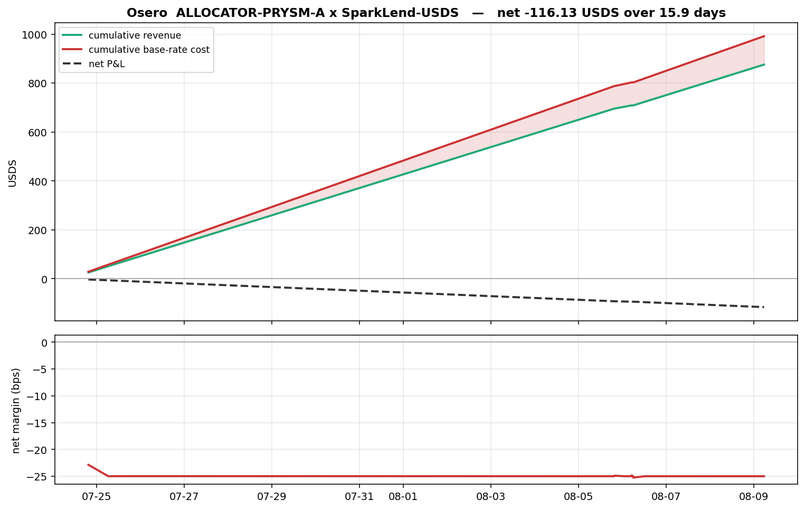

#+TITLE: Is Osero Making Money?
#+SUBTITLE: An on-chain reconstruction, from two anchors to a basis-point answer
#+OPTIONS: toc:2 num:t

* The question

Osero is a *Star* in the Sky ecosystem. Sky extends it a USDS credit line; Osero draws
against that line, deploys the USDS into a yield strategy, and owes Sky a *base rate* on
the capital it actually uses.

#+BEGIN_QUOTE
*base rate = Sky Savings Rate (SSR) + 20 bps*, charged only on the portion of deployed
USDS that is *actually borrowed downstream*.
#+END_QUOTE

Three things make this hard, and they are the whole exercise:

1. *No contract reports the answer.* The stability fee on the allocator ilk is zero. The
   base-rate obligation is a commercial arrangement, not an on-chain accrual. You compute
   it, or it does not exist.
2. *We are given two anchors and nothing else* -- an ilk name and a proxy address. The
   venue, the vault, the buffer, the rates and the position history all have to be found.
3. *Every input moves.* SSR is a governance parameter, utilization drifts block to block,
   and the position itself gets topped up and rebalanced.

This notebook starts from the two anchors and ends at a number. Everything in between is
read live from Ethereum mainnet -- no hardcoded results, no oracle values read into the
answer.

*The short version:* Osero borrows from Sky at SSR + 20 bps and lends into SparkLend --
also Sky -- at a supply rate below that base. It is *losing roughly 25 bps*, structurally,
at current rates.

** Relationship to the rest of this repo

This document is the narrated, executable version of the research. It is deliberately
independent: it re-derives every number from scratch using only ~requests~, so it can be
checked against the other two layers without sharing code with them.

| Layer                             | What it is                                                           |
|-----------------------------------+----------------------------------------------------------------------|
| =DISCOVERY.org= (this file)       | Narrated notebook: anchors → answer, self-contained                  |
| [[file:discovery/][=discovery/=]]           | The autonomous agent's run: 17 graded hypotheses, one indexer each   |
| [[file:osero-indexer/][=osero-indexer/=]]      | Production Rust daemon: event-sourced, feeds a live dashboard        |
| [[file:RESEARCH.md][=RESEARCH.md=]]        | The writeup: contract appendix, discovery log, economics, validation |

** How to run it

Requires an HTTPS Ethereum mainnet RPC *with archive reads* in =.env= at the repo root:

#+BEGIN_EXAMPLE
ETH_RPC_URL=https://mainnet.infura.io/v3/<your-key>
#+END_EXAMPLE

Dependencies are deliberately minimal: =requests= for JSON-RPC and =matplotlib= for one
chart. No =web3=, no =eth-abi=, no Foundry -- the ABI encoding and Keccak are done by hand
below, so nothing between us and the chain can quietly supply an answer.

A note on cost, because it shapes the method: this notebook is written to run on a *free-tier
RPC*. Free tiers throttle =eth_getLogs= aggressively (it is by far the most expensive method),
so wherever a log scan can be replaced by a handful of archive =eth_call= reads, it has been.
That constraint turned out to be a feature -- see Steps 4 and 6, where bisection on contract
state recovers history more cheaply, and more robustly, than scanning events.

* Setup

** Keccak-256

Python's =hashlib.sha3_256= is *not* Keccak-256 -- the padding differs, and Ethereum uses the
original Keccak. We need it for function selectors and event topics, and it is the only real
reason a notebook like this normally pulls in a dependency. It is 30 lines, so here it is.

#+BEGIN_SRC jupyter-python :session osero :kernel llms_kernel :async yes :exports both
_RC = [0x0000000000000001, 0x0000000000008082, 0x800000000000808A, 0x8000000080008000,
       0x000000000000808B, 0x0000000080000001, 0x8000000080008081, 0x8000000000008009,
       0x000000000000008A, 0x0000000000000088, 0x0000000080008009, 0x000000008000000A,
       0x000000008000808B, 0x800000000000008B, 0x8000000000008089, 0x8000000000008003,
       0x8000000000008002, 0x8000000000000080, 0x000000000000800A, 0x800000008000000A,
       0x8000000080008081, 0x8000000000008080, 0x0000000080000001, 0x8000000080008008]
_ROT = [[0, 36, 3, 41, 18], [1, 44, 10, 45, 2], [62, 6, 43, 15, 61],
        [28, 55, 25, 21, 56], [27, 20, 39, 8, 14]]
_M = (1 << 64) - 1

def _rol(x, n):
    return ((x << n) | (x >> (64 - n))) & _M

def _keccak_f1600(A):
    for rnd in range(24):
        C = [A[x][0] ^ A[x][1] ^ A[x][2] ^ A[x][3] ^ A[x][4] for x in range(5)]
        D = [C[(x - 1) % 5] ^ _rol(C[(x + 1) % 5], 1) for x in range(5)]
        for x in range(5):
            for y in range(5):
                A[x][y] ^= D[x]
        B = [[0] * 5 for _ in range(5)]
        for x in range(5):
            for y in range(5):
                B[y][(2 * x + 3 * y) % 5] = _rol(A[x][y], _ROT[x][y])
        for x in range(5):
            for y in range(5):
                A[x][y] = B[x][y] ^ ((~B[(x + 1) % 5][y]) & _M) & B[(x + 2) % 5][y]
        A[0][0] ^= _RC[rnd]
    return A

def keccak256(data: bytes) -> bytes:
    """Keccak-256 (Ethereum's, not NIST SHA3-256 -- different padding)."""
    rate = 136
    p = bytearray(data)
    p.append(0x01)
    while len(p) % rate:
        p.append(0)
    p[-1] ^= 0x80
    A = [[0] * 5 for _ in range(5)]
    for off in range(0, len(p), rate):
        blk = p[off:off + rate]
        for i in range(rate // 8):
            A[i % 5][i // 5] ^= int.from_bytes(blk[i * 8:i * 8 + 8], "little")
        A = _keccak_f1600(A)
    out = b"".join(A[i % 5][i // 5].to_bytes(8, "little") for i in range(4))
    return out[:32]

# Self-test against two universally known vectors. If these pass, every selector
# and topic derived below is trustworthy.
assert keccak256(b"").hex() == \
    "c5d2460186f7233c927e7db2dcc703c0e500b653ca82273b7bfad8045d85a470"
assert keccak256(b"Transfer(address,address,uint256)").hex() == \
    "ddf252ad1be2c89b69c2b068fc378daa952ba7f163c4a11628f55a4df523b3ef"
print("keccak256 self-test passed")
#+END_SRC

#+RESULTS:
: keccak256 self-test passed

** JSON-RPC, ABI encoding, units

A paced, retrying JSON-RPC client (free tiers rate-limit and return transient
=service temporarily unavailable=), plus just enough ABI machinery: every call we make
takes static arguments (=address=, =bytes32=) and returns static words, so hand-rolled
encode/decode is a few lines rather than a library.

#+BEGIN_SRC jupyter-python :session osero :kernel llms_kernel :async yes :exports both
import os, time, json, requests
from pathlib import Path

# Find the repo root (this notebook lives there) and load .env without exporting secrets.
HERE = Path.cwd()
while not (HERE / ".env").exists() and HERE != HERE.parent:
    HERE = HERE.parent
for line in (HERE / ".env").read_text().splitlines():
    line = line.strip()
    if line and not line.startswith("#") and "=" in line:
        k, v = line.split("=", 1)
        os.environ.setdefault(k.strip(), v.strip())

RPC = os.environ["ETH_RPC_URL"]
_session = requests.Session()
_last_call = [0.0]
RPC_INTERVAL = 0.12          # min seconds between calls; raise if you get throttled

def rpc(method, params, retries=10):
    """Paced JSON-RPC with backoff on the transient errors free tiers love to emit."""
    for i in range(retries):
        wait = RPC_INTERVAL - (time.time() - _last_call[0])
        if wait > 0:
            time.sleep(wait)
        _last_call[0] = time.time()
        try:
            r = _session.post(RPC, timeout=90,
                              json={"jsonrpc": "2.0", "id": 1,
                                    "method": method, "params": params})
            if r.status_code == 429:
                time.sleep(2 * (i + 1)); continue
            r.raise_for_status()
            j = r.json()
            if "error" in j:
                e = j["error"]
                if e.get("code") in (-32005, -32603):     # rate limit / transient
                    time.sleep(2 * (i + 1)); continue
                raise RuntimeError(f"{method}: {e}")
            return j["result"]
        except requests.RequestException:
            time.sleep(2 * (i + 1))
    raise RuntimeError(f"rpc failed after {retries} tries: {method}")

# --- ABI: selectors, topics, static encode/decode ---------------------------
def selector(sig):  return "0x" + keccak256(sig.encode()).hex()[:8]
def topic0(sig):    return "0x" + keccak256(sig.encode()).hex()
def enc_addr(a):    return a.lower().replace("0x", "").rjust(64, "0")
def enc_b32(s):
    b = s.encode(); assert len(b) <= 32
    return b.hex() + "00" * (32 - len(b))
def dec_b32(h):
    h = h[2:] if h.startswith("0x") else h
    return bytes.fromhex(h).rstrip(b"\x00").decode(errors="replace")

def eth_call(to, sig, *args, block="latest"):
    data = selector(sig) + "".join(args)
    return rpc("eth_call", [{"to": to, "data": data},
                            block if block == "latest" else hex(block)])

def word(h, i=0):      return int(h[2 + i * 64: 2 + (i + 1) * 64], 16)
def addr_at(h, i=0):   return "0x" + h[2 + i * 64: 2 + (i + 1) * 64][24:]
def call_uint(to, sig, *a, block="latest"): return word(eth_call(to, sig, *a, block=block))
def call_str(to, sig, block="latest"):
    """Decode a dynamic `string` return (offset, length, bytes)."""
    h = eth_call(to, sig, block=block)
    n = int(h[2 + 64: 2 + 128], 16)
    return bytes.fromhex(h[2 + 128: 2 + 128 + n * 2]).decode()

def block_ts(b):
    return int(rpc("eth_getBlockByNumber", [hex(b), False])["timestamp"], 16)

# --- Sky / Aave fixed-point units -------------------------------------------
WAD, RAY, RAD = 10**18, 10**27, 10**45
SECONDS_PER_YEAR = 365 * 24 * 3600

HEAD = int(rpc("eth_blockNumber", []), 16)
print(f"chain id   {int(rpc('eth_chainId', []), 16)}")
print(f"head block {HEAD:,}")
#+END_SRC

#+RESULTS:
#+begin_example
chain id   1
head block 25,715,376
#+end_example

* The two anchors

Everything below is derived from these. The ilk is a =bytes32= string; Prysm is Osero's
former name, and the on-chain identifiers still use it.

#+BEGIN_SRC jupyter-python :session osero :kernel llms_kernel :async yes :exports both
ILK_NAME = "ALLOCATOR-PRYSM-A"
ILK      = enc_b32(ILK_NAME)
PROXY    = "0x6d370e359e9cbd0Fd35Bb38fAF705D84238CB884"   # ALM proxy -- holds the position

print(f"ilk       {ILK_NAME}")
print(f"  bytes32 0x{ILK}")
print(f"ALM proxy {PROXY}")
#+END_SRC

#+RESULTS:
#+begin_example
ilk       ALLOCATOR-PRYSM-A
  bytes32 0x414c4c4f4341544f522d505259534d2d41000000000000000000000000000000
ALM proxy 0x6d370e359e9cbd0Fd35Bb38fAF705D84238CB884
#+end_example

* Step 1 -- The Sky Chainlog

The Chainlog is Sky's on-chain service registry: a =bytes32 key → address= map that names
every core contract. It is the entry point, but the brief is explicit that we should not
trust a hardcoded address for it -- so we verify it against itself. A genuine chainlog
resolves the key =CHANGELOG= to its own address.

#+BEGIN_SRC jupyter-python :session osero :kernel llms_kernel :async yes :exports both
CHAINLOG = "0xdA0Ab1e0017DEbCd72Be8599041a2aa3bA7e740F"

self_ref = addr_at(eth_call(CHAINLOG, "getAddress(bytes32)", enc_b32("CHANGELOG")))
print(f"getAddress('CHANGELOG') -> {self_ref}")
print(f"self-consistent?          {self_ref.lower() == CHAINLOG.lower()}")
print(f"version                   {call_str(CHAINLOG, 'version()')}")
print(f"entries                   {call_uint(CHAINLOG, 'count()')}")
#+END_SRC

#+RESULTS:
#+begin_example
getAddress('CHANGELOG') -> 0xda0ab1e0017debcd72be8599041a2aa3ba7e740f
self-consistent?          True
version                   1.20.18
entries                   513
#+end_example

It self-references, so we have the real registry. Now enumerate every key and look for our
ilk. We do not guess the naming convention -- we decode all 500-odd keys and grep.

#+BEGIN_SRC jupyter-python :session osero :kernel llms_kernel :async yes :exports both
raw = eth_call(CHAINLOG, "list()")            # bytes32[] : offset, length, then entries
n_keys = word(raw, 1)
KEYS = [dec_b32(raw[2 + (2 + i) * 64: 2 + (3 + i) * 64]) for i in range(n_keys)]

prysm = [k for k in KEYS if "PRYSM" in k]
print(f"{n_keys} keys in the chainlog; {len(prysm)} mention PRYSM:")
for k in prysm:
    print(f"   {k}")
#+END_SRC

#+RESULTS:
#+begin_example
513 keys in the chainlog; 4 mention PRYSM:
   ALLOCATOR_PRYSM_A_VAULT
   ALLOCATOR_PRYSM_A_BUFFER
   PRYSM_SUBPROXY
   PRYSM_STARGUARD
#+end_example

There it is: the allocator vault and buffer for our ilk are named in the registry. Resolve
those, plus the core Sky contracts we will need for the debt and the savings rate.

#+BEGIN_SRC jupyter-python :session osero :kernel llms_kernel :async yes :exports both
WANT = ["ALLOCATOR_PRYSM_A_VAULT", "ALLOCATOR_PRYSM_A_BUFFER", "PRYSM_SUBPROXY",
        "ALLOCATOR_REGISTRY", "MCD_VAT", "MCD_JUG", "USDS", "SUSDS"]
SKY = {k: addr_at(eth_call(CHAINLOG, "getAddress(bytes32)", enc_b32(k))) for k in WANT}

ROLES = {
    "ALLOCATOR_PRYSM_A_VAULT":  "draws USDS against the ilk",
    "ALLOCATOR_PRYSM_A_BUFFER": "holds the drawn USDS",
    "PRYSM_SUBPROXY":           "Osero's governance proxy",
    "ALLOCATOR_REGISTRY":       "ilk -> buffer registry",
    "MCD_VAT":                  "CDP engine -- holds the debt",
    "MCD_JUG":                  "stability-fee module",
    "USDS":                     "the stablecoin drawn",
    "SUSDS":                    "savings USDS -- the SSR source",
}
for k, a in SKY.items():
    print(f"  {k:26} {a}  {ROLES[k]}")

VAULT, BUFFER = SKY["ALLOCATOR_PRYSM_A_VAULT"], SKY["ALLOCATOR_PRYSM_A_BUFFER"]
VAT, JUG      = SKY["MCD_VAT"], SKY["MCD_JUG"]
USDS, SUSDS   = SKY["USDS"], SKY["SUSDS"]
REGISTRY      = SKY["ALLOCATOR_REGISTRY"]
#+END_SRC

#+RESULTS:
#+begin_example
  ALLOCATOR_PRYSM_A_VAULT    0x146181aa9b362eaec2ec3add7429a06d53b43d1a  draws USDS against the ilk
  ALLOCATOR_PRYSM_A_BUFFER   0xd0bb61b34771146e31055f20f329cdf97429f889  holds the drawn USDS
  PRYSM_SUBPROXY             0x24fdcd3bfa5c2553e05b2f9ad0365ebc296278d3  Osero's governance proxy
  ALLOCATOR_REGISTRY         0xcdcfa95343da7821fdd01dc4d0aeda958051bb3b  ilk -> buffer registry
  MCD_VAT                    0x35d1b3f3d7966a1dfe207aa4514c12a259a0492b  CDP engine -- holds the debt
  MCD_JUG                    0x19c0976f590d67707e62397c87829d896dc0f1f1  stability-fee module
  USDS                       0xdc035d45d973e3ec169d2276ddab16f1e407384f  the stablecoin drawn
  SUSDS                      0xa3931d71877c0e7a3148cb7eb4463524fec27fbd  savings USDS -- the SSR source
#+end_example

* Step 2 -- Confirming the vault and buffer belong to our ilk

Names in a registry are a lead, not proof. Two independent confirmations: the vault should
report our ilk, and the registry's =buffers(ilk)= lookup should return the same buffer the
vault points at.

#+BEGIN_SRC jupyter-python :session osero :kernel llms_kernel :async yes :exports both
vault_ilk      = dec_b32(eth_call(VAULT, "ilk()"))
vault_buffer   = addr_at(eth_call(VAULT, "buffer()"))
registry_buffer = addr_at(eth_call(REGISTRY, "buffers(bytes32)", ILK))

print(f"vault.ilk()            = {vault_ilk!r}   match: {vault_ilk == ILK_NAME}")
print(f"vault.buffer()         = {vault_buffer}")
print(f"registry.buffers(ilk)  = {registry_buffer}")
print(f"buffer agrees          = {vault_buffer == registry_buffer == BUFFER.lower()}")
#+END_SRC

#+RESULTS:
#+begin_example
vault.ilk()            = 'ALLOCATOR-PRYSM-A'   match: True
vault.buffer()         = 0xd0bb61b34771146e31055f20f329cdf97429f889
registry.buffers(ilk)  = 0xd0bb61b34771146e31055f20f329cdf97429f889
buffer agrees          = True
#+end_example

* Step 3 -- The debt, and the rate that isn't there

The Vat is Sky's CDP engine. For an ilk/urn pair it stores =ink= (collateral) and =art=
(normalized debt); actual debt is =art × rate=, where =rate= is the ilk's accumulated
stability-fee index. The Jug holds =duty=, the per-second fee rate.

This is where the exercise's central mechanic becomes concrete.

#+BEGIN_SRC jupyter-python :session osero :kernel llms_kernel :async yes :exports both
urn  = eth_call(VAT, "urns(bytes32,address)", ILK, enc_addr(VAULT))
ink, art = word(urn, 0), word(urn, 1)

ilks = eth_call(VAT, "ilks(bytes32)", ILK)
Art, rate, spot, line, dust = (word(ilks, i) for i in range(5))

duty = word(eth_call(JUG, "ilks(bytes32)", ILK), 0)

DEBT = art * rate // RAY / WAD
print(f"urn.art (normalized debt)  {art / WAD:>16,.2f}")
print(f"ilk.rate (fee index)       {rate / RAY:>16.9f}  RAY")
print(f"debt = art x rate          {DEBT:>16,.2f}  USDS")
print(f"debt ceiling (line)        {line / RAD:>16,.0f}  USDS")
print()
print(f"jug.duty                   {duty / RAY:>16.9f}  RAY/sec")
print(f"=> annual stability fee    {(duty / RAY) ** SECONDS_PER_YEAR - 1:>16.10%}")
#+END_SRC

#+RESULTS:
#+begin_example
urn.art (normalized debt)      1,001,000.00
ilk.rate (fee index)            1.000000000  RAY
debt = art x rate              1,001,000.00  USDS
debt ceiling (line)               2,000,000  USDS

jug.duty                        1.000000000  RAY/sec
=> annual stability fee       0.0000000000%
#+end_example

*The stability fee is exactly zero.* =rate= is unity and =duty= is unity -- Sky charges this
ilk nothing on-chain. So the SSR + 20 bps obligation genuinely is not recorded anywhere on
the chain. It is a commercial arrangement between Osero and Sky, and the entire cost side of
this P&L has to be constructed from parameters that live in other contracts.

That is the single most important fact in this exercise. A naive P&L that reads the ilk's
accrued fee would conclude Osero's funding is free, and report a healthy profit.

* Step 4 -- When did this position start?

We need the position's inception to bound every historical query. Two ways to find it, both
cheap, neither requiring a log scan.

First, when did the ALM proxy come into existence? Binary-search =eth_getCode=: it returns
empty before deployment and non-empty after, which is monotonic, so bisection is exact.

#+BEGIN_SRC jupyter-python :session osero :kernel llms_kernel :async yes :exports both
def bisect_first(pred, lo, hi):
    """Smallest block in [lo, hi] where pred(block) is True. Requires pred monotonic."""
    calls = 0
    while lo < hi:
        mid = (lo + hi) // 2
        calls += 1
        if pred(mid):
            hi = mid
        else:
            lo = mid + 1
    return lo, calls

t0 = time.time()
PROXY_BIRTH, n = bisect_first(lambda b: rpc("eth_getCode", [PROXY, hex(b)]) != "0x", 0, HEAD)
print(f"ALM proxy deployed at block {PROXY_BIRTH:,}  ({n} eth_getCode calls, {time.time()-t0:.0f}s)")
#+END_SRC

#+RESULTS:
: ALM proxy deployed at block 25,383,064  (25 eth_getCode calls, 7s)

But deployment is not the *economic* inception -- the proxy existed for a while before any
money moved. The economically meaningful start is the first draw, which is the first block
where the urn's debt is non-zero. Same bisection, against archive state.

#+BEGIN_SRC jupyter-python :session osero :kernel llms_kernel :async yes :exports both
def art_at(b):
    return word(eth_call(VAT, "urns(bytes32,address)", ILK, enc_addr(VAULT), block=b), 1)

t0 = time.time()
INCEPTION, n = bisect_first(lambda b: art_at(b) > 0, PROXY_BIRTH, HEAD)
print(f"first draw at block {INCEPTION:,}  ({n} archive calls, {time.time()-t0:.0f}s)")
print(f"  debt just before  {art_at(INCEPTION - 1) / WAD:>14,.2f} USDS")
print(f"  debt at that block{art_at(INCEPTION) / WAD:>14,.2f} USDS")
print(f"  proxy existed for {INCEPTION - PROXY_BIRTH:,} blocks before drawing")
#+END_SRC

#+RESULTS:
#+begin_example
first draw at block 25,601,435  (19 archive calls, 6s)
  debt just before            0.00 USDS
  debt at that block  1,000,000.00 USDS
  proxy existed for 218,371 blocks before drawing
#+end_example

* Step 5 -- Following the money: where is the capital deployed?

Now the discovery question the brief actually cares about. Osero drew USDS; where did it go?

We know the exact block of the first draw, which makes this a *one-block log query* rather
than a scan of the chain -- cheap enough to survive any rate limit. Filter USDS =Transfer=
events with the proxy as sender.

#+BEGIN_SRC jupyter-python :session osero :kernel llms_kernel :async yes :exports both
TRANSFER = topic0("Transfer(address,address,uint256)")
P_TOPIC  = "0x" + enc_addr(PROXY)

def usds_transfers(from_block, to_block, sender=None, receiver=None):
    topics = [TRANSFER, sender, receiver]
    while topics and topics[-1] is None:
        topics.pop()
    return rpc("eth_getLogs", [{"address": USDS, "topics": topics,
                                "fromBlock": hex(from_block), "toBlock": hex(to_block)}])

out = usds_transfers(INCEPTION, INCEPTION, sender=P_TOPIC)
print(f"USDS transfers out of the ALM proxy in block {INCEPTION:,}: {len(out)}")
for lg in out:
    dest = "0x" + lg["topics"][2][-40:]
    print(f"   -> {dest}   {int(lg['data'], 16) / WAD:,.2f} USDS")

VENUE_TOKEN = "0x" + out[0]["topics"][2][-40:]
#+END_SRC

#+RESULTS:
#+begin_example
USDS transfers out of the ALM proxy in block 25,601,435: 1
   -> 0xc02ab1a5eaa8d1b114ef786d9bde108cd4364359   1,000,000.00 USDS
#+end_example

A single destination, receiving the entire draw. Ask that contract what it is.

#+BEGIN_SRC jupyter-python :session osero :kernel llms_kernel :async yes :exports both
ATOKEN     = VENUE_TOKEN
POOL       = addr_at(eth_call(ATOKEN, "POOL()"))
UNDERLYING = addr_at(eth_call(ATOKEN, "UNDERLYING_ASSET_ADDRESS()"))

print(f"token      {ATOKEN}")
print(f"  symbol   {call_str(ATOKEN, 'symbol()')}")
print(f"  name     {call_str(ATOKEN, 'name()')}")
print(f"  POOL()   {POOL}")
print(f"  underlying {UNDERLYING}  (== USDS: {UNDERLYING == USDS.lower()})")
#+END_SRC

#+RESULTS:
#+begin_example
token      0xc02ab1a5eaa8d1b114ef786d9bde108cd4364359
  symbol   spUSDS
  name     Spark USDS
  POOL()   0xc13e21b648a5ee794902342038ff3adab66be987
  underlying 0xdc035d45d973e3ec169d2276ddab16f1e407384f  (== USDS: True)
#+end_example

*The venue is SparkLend's USDS reserve* -- an Aave-V3-fork lending market. =spUSDS= is the
aToken receipt. This is worth pausing on, because it is the finding that decides the answer:
Osero borrows from Sky and lends into *Spark, which is also Sky*. The two legs of the trade
are the same ecosystem, and the spread between them is the entire business.

It is also emphatically *not* sUSDS. The public Osero documentation describes a retail
product that routes deposits into sUSDS to earn SSR; that is a different leg of the business.
Depositing drawn USDS into sUSDS would earn SSR while owing SSR + 20 bps -- a guaranteed
20 bps loss by construction. The docs were a red herring here, and following them would have
produced a confidently wrong model.

Pull the rest of the reserve's contracts from the pool while we are here.

#+BEGIN_SRC jupyter-python :session osero :kernel llms_kernel :async yes :exports both
# Aave V3 getReserveData returns a static 15-word struct.
RD_LIQUIDITY_INDEX, RD_LIQUIDITY_RATE, RD_BORROW_RATE = 1, 2, 4
RD_ATOKEN, RD_VDEBT = 8, 10

def reserve_data(block="latest"):
    return eth_call(POOL, "getReserveData(address)", enc_addr(USDS), block=block)

rd = reserve_data()
VDEBT = addr_at(rd, RD_VDEBT)
print(f"aToken            {addr_at(rd, RD_ATOKEN)}  (matches: {addr_at(rd, RD_ATOKEN) == ATOKEN})")
print(f"variableDebtToken {VDEBT}")
print(f"liquidityIndex    {word(rd, RD_LIQUIDITY_INDEX) / RAY:.9f}")
#+END_SRC

#+RESULTS:
#+begin_example
aToken            0xc02ab1a5eaa8d1b114ef786d9bde108cd4364359  (matches: True)
variableDebtToken 0x8c147debea24fb98ade8dda4bf142992928b449e
liquidityIndex    1.038912579
#+end_example

* Step 6 -- The principal history, without reading a single event log

To integrate cost over the position's life we need every deposit and withdrawal. The obvious
route is scanning =Transfer= logs, which is exactly the query free-tier RPCs throttle hardest.

There is a better way, and it comes from how Aave accounts. An aToken stores a *scaled*
balance -- the balance divided by the reserve's liquidity index. Interest accrues by the index
rising, which leaves the scaled balance untouched. So:

#+BEGIN_QUOTE
=scaledBalanceOf= is a *step function*. It changes only when principal actually moves.
#+END_QUOTE

That makes the deposit history recoverable by bisection: repeatedly find the first block
where the scaled balance differs from its current value. Each step costs ~log₂(range) archive
calls, and we read no logs at all.

#+BEGIN_SRC jupyter-python :session osero :kernel llms_kernel :async yes :exports both
_scaled_calls = [0]
def scaled_at(b):
    _scaled_calls[0] += 1
    return word(eth_call(ATOKEN, "scaledBalanceOf(address)", enc_addr(PROXY), block=b))

t0 = time.time()
STEPS = []                       # (block, delta_scaled)
cur, cur_v = INCEPTION - 1, scaled_at(INCEPTION - 1)
end_v = scaled_at(HEAD)
while cur_v != end_v:
    nxt, _ = bisect_first(lambda b: scaled_at(b) != cur_v, cur, HEAD)
    nv = scaled_at(nxt)
    STEPS.append((nxt, nv - cur_v))
    cur, cur_v = nxt, nv

print(f"{len(STEPS)} principal movements found "
      f"({_scaled_calls[0]} archive calls, {time.time()-t0:.0f}s)\n")
print(f"{'block':>12} {'scaled delta':>18}")
for b, d in STEPS:
    print(f"{b:>12} {d / WAD:>+18,.6f}")
#+END_SRC

#+RESULTS:
#+begin_example
5 principal movements found (85 archive calls, 23s)

       block       scaled delta
    25601435    +963,390.878288
    25681464        +962.792231
    25690834    -385,088.852873
    25693684    -579,264.817645
    25693959    +964,343.092005
#+end_example

Scaled deltas are index-denominated, so convert each to the USDS amount that actually moved
by multiplying through the live index at that block. Then check the identity that matters:
*the net principal Osero has supplied should equal the debt it drew from Sky.*

#+BEGIN_SRC jupyter-python :session osero :kernel llms_kernel :async yes :exports both
def normalized_income(b):
    """Live liquidity index including accrual since lastUpdate -- what balanceOf uses."""
    return call_uint(POOL, "getReserveNormalizedIncome(address)", enc_addr(USDS), block=b)

FLOWS = []                       # (block, usds_amount) -- signed
for b, d in STEPS:
    FLOWS.append((b, d * normalized_income(b) // RAY / WAD))

print(f"{'block':>12} {'USDS moved':>18}   direction")
for b, amt in FLOWS:
    print(f"{b:>12} {amt:>+18,.2f}   {'deposit' if amt > 0 else 'WITHDRAWAL'}")

NET_PRINCIPAL = sum(a for _, a in FLOWS)
print(f"\nnet principal supplied  {NET_PRINCIPAL:>16,.2f} USDS")
print(f"debt drawn from Sky     {DEBT:>16,.2f} USDS")
print(f"difference              {NET_PRINCIPAL - DEBT:>16,.2f} USDS")
#+END_SRC

#+RESULTS:
#+begin_example
       block         USDS moved   direction
    25601435      +1,000,000.00   deposit
    25681464          +1,000.00   deposit
    25690834        -400,000.00   WITHDRAWAL
    25693684        -601,708.02   WITHDRAWAL
    25693959      +1,001,708.02   deposit

net principal supplied      1,001,000.00 USDS
debt drawn from Sky         1,001,000.00 USDS
difference                          0.00 USDS
#+end_example

The two sides close: every USDS Osero drew from Sky is accounted for in the venue. That is
the flow-vs-stock reconciliation that makes the rest of the numbers trustworthy -- it means we
have found *all* the capital movements, not just the ones we went looking for.

* Step 7 -- A round trip: did the strategy change?

The history above is not the simple "draw once, deposit once" story. There are withdrawals,
including one that takes the position to zero, followed by a redeposit. Money leaving the
venue entirely is exactly what a *change of strategy* would look like -- a second venue would
invalidate the single-venue model this whole P&L rests on.

So test it directly. If the capital left SparkLend and went somewhere else, then during the
gap the proxy's own USDS balance would *not* account for the missing position. If instead it
simply sat idle in the proxy, then =USDS + spUSDS= stays conserved across the whole window.

#+BEGIN_SRC jupyter-python :session osero :kernel llms_kernel :async yes :exports both
gap_lo = min(b for b, a in FLOWS if a < 0)
gap_hi = max(b for b, _ in FLOWS)
probes = sorted({gap_lo - 1, gap_lo, gap_hi - 1, gap_hi, gap_hi + 1} |
                {gap_lo + (gap_hi - gap_lo) * i // 4 for i in range(1, 4)})

print(f"{'block':>12} {'USDS in proxy':>16} {'spUSDS position':>18} {'total':>16}")
for b in probes:
    u = call_uint(USDS,   "balanceOf(address)", enc_addr(PROXY), block=b) / WAD
    s = call_uint(ATOKEN, "balanceOf(address)", enc_addr(PROXY), block=b) / WAD
    print(f"{b:>12} {u:>16,.2f} {s:>18,.2f} {u + s:>16,.2f}")
#+END_SRC

#+RESULTS:
#+begin_example
       block    USDS in proxy    spUSDS position            total
    25690833             0.00       1,001,694.71     1,001,694.71
    25690834       400,000.00         601,694.71     1,001,694.71
    25691615       400,000.00         601,698.36     1,001,698.36
    25692396       400,000.00         601,702.01     1,001,702.01
    25693177       400,000.00         601,705.66     1,001,705.66
    25693958     1,001,708.02               0.00     1,001,708.02
    25693959             0.00       1,001,708.02     1,001,708.02
    25693960             0.00       1,001,708.03     1,001,708.03
#+end_example

Conserved throughout, and never decreasing. The capital came out of SparkLend, sat in the
proxy, and went straight back into SparkLend -- 400k of it for about ten hours, the whole
position for the final hour. *No second venue* -- the single-strategy model holds.

It is not free, though: while idle in the proxy the capital earns nothing. That shows up
below as a visible flat spot in cumulative revenue. Whether it also pauses the *cost* is a
judgement call -- capital sitting in a proxy is not borrowed by anyone downstream, so under
the brief's own rule ("idle liquidity sitting unborrowed costs Osero nothing") it should not
accrue base rate either. We model it that way, which is the conservative choice: it makes the
loss *smaller* than the alternative.

* Step 8 -- The revenue leg

Revenue is the supply interest earned in the venue. There are two ways to get it, and using
both is the point -- one is exact but says nothing about *rates*, the other is rate-based and
therefore extrapolatable. They must agree.

The exact one first. Osero's total value in the venue minus what it put in *is* the realized
interest, with no rate model, no compounding convention, and no sampling error.

#+BEGIN_SRC jupyter-python :session osero :kernel llms_kernel :async yes :exports both
POSITION = call_uint(ATOKEN, "balanceOf(address)", enc_addr(PROXY)) / WAD
REALIZED_REVENUE = POSITION - NET_PRINCIPAL

print(f"position (spUSDS balanceOf)  {POSITION:>16,.2f} USDS")
print(f"net principal supplied       {NET_PRINCIPAL:>16,.2f} USDS")
print(f"realized interest (exact)    {REALIZED_REVENUE:>16,.2f} USDS")
#+END_SRC

#+RESULTS:
#+begin_example
position (spUSDS balanceOf)      1,001,874.83 USDS
net principal supplied           1,001,000.00 USDS
realized interest (exact)              874.83 USDS
#+end_example

Now the rate. Aave quotes =currentLiquidityRate= as an annualized nominal rate in RAY. Two
conventions are available and they differ by ~2 bps, which matters at the precision we are
working to -- so we will keep both and let a reconciliation decide which the chain actually uses.

#+BEGIN_SRC jupyter-python :session osero :kernel llms_kernel :async yes :exports both
def supply_rates(block="latest"):
    r = word(reserve_data(block), RD_LIQUIDITY_RATE) / RAY
    return r, (1 + r / SECONDS_PER_YEAR) ** SECONDS_PER_YEAR - 1    # nominal APR, compounded APY

SUPPLY_APR, SUPPLY_APY = supply_rates()
print(f"currentLiquidityRate  {SUPPLY_APR:>10.6%}   nominal APR")
print(f"                      {SUPPLY_APY:>10.6%}   per-second compounded APY")
print(f"variableBorrowRate    {word(reserve_data(), RD_BORROW_RATE) / RAY:>10.6%}   nominal APR")
#+END_SRC

#+RESULTS:
#+begin_example
currentLiquidityRate   2.035110%   nominal APR
                       2.055959%   per-second compounded APY
variableBorrowRate     3.648493%   nominal APR
#+end_example

* Step 9 -- The cost leg

Three ingredients, none of which appear on the ilk: the savings rate, the fixed spread, and
the share of Osero's capital that is actually borrowed downstream.

*The Sky Savings Rate.* =sUSDS.ssr()= is a per-second rate in RAY that compounds -- so the
annual figure is =ssr^secondsPerYear=, not a multiplication.

#+BEGIN_SRC jupyter-python :session osero :kernel llms_kernel :async yes :exports both
SPREAD = 0.0020          # +20 bps -- the off-chain commercial term from the brief

def ssr_rates(block="latest"):
    ray = call_uint(SUSDS, "ssr()", block=block)
    return ((ray - RAY) / RAY * SECONDS_PER_YEAR,        # nominal APR
            (ray / RAY) ** SECONDS_PER_YEAR - 1)         # compounded APY

SSR_APR, SSR_APY = ssr_rates()
print(f"sUSDS.ssr()   {call_uint(SUSDS, 'ssr()')}  RAY/sec")
print(f"  SSR         {SSR_APY:>10.4%}  compounded APY")
print(f"              {SSR_APR:>10.4%}  nominal APR")
print(f"base rate     {SSR_APY + SPREAD:>10.4%}  = SSR + 20 bps")
#+END_SRC

#+RESULTS:
#+begin_example
sUSDS.ssr()   1000000001096988989836188433  RAY/sec
  SSR            3.5200%  compounded APY
                 3.4595%  nominal APR
base rate        3.7200%  = SSR + 20 bps
#+end_example

*Utilization.* The base rate applies only to the borrowed portion. A fungible lending pool has
no per-lender utilization -- every supplier's capital is equally lent out -- so the pool-wide
ratio is the right proxy for Osero's share. Numerator: total variable debt. Denominator: total
supplied.

#+BEGIN_SRC jupyter-python :session osero :kernel llms_kernel :async yes :exports both
def utilization(block="latest"):
    supplied = call_uint(ATOKEN, "totalSupply()", block=block)
    borrowed = call_uint(VDEBT,  "totalSupply()", block=block)
    return borrowed / supplied if supplied else 0.0, supplied / WAD, borrowed / WAD

UTIL, SUPPLIED, BORROWED = utilization()
print(f"total supplied to reserve  {SUPPLIED:>16,.2f} USDS")
print(f"total borrowed from it     {BORROWED:>16,.2f} USDS")
print(f"utilization                {UTIL:>16.4%}")
print()
print(f"Osero's position           {POSITION:>16,.2f} USDS")
print(f"  = {POSITION / SUPPLIED:.4%} of the reserve")
print(f"  borrowed portion         {UTIL * POSITION:>16,.2f} USDS  <- base rate applies to this")
print(f"  idle portion             {(1 - UTIL) * POSITION:>16,.2f} USDS  <- costs nothing")
#+END_SRC

#+RESULTS:
#+begin_example
total supplied to reserve    722,817,834.87 USDS
total borrowed from it       448,038,796.02 USDS
utilization                        61.9850%

Osero's position               1,001,874.83 USDS
  = 0.1386% of the reserve
  borrowed portion               621,012.34 USDS  <- base rate applies to this
  idle portion                   380,862.49 USDS  <- costs nothing
#+end_example

Note the size: Osero is a *0.14% supplier* in this reserve. That matters for interpretation --
Osero is a price-taker here. It cannot move the utilization or the supply rate in its own
favour, so the loss below is not something it can trade its way out of at this scale.

* Step 10 -- The spot answer

Per unit of position: Osero earns the supply rate on all of it, and owes the base rate on the
borrowed fraction of it.

#+BEGIN_QUOTE
*margin = supplyRate − baseRate × utilization*
#+END_QUOTE

#+BEGIN_SRC jupyter-python :session osero :kernel llms_kernel :async yes :exports both
BASE = SSR_APY + SPREAD
revenue_rate = SUPPLY_APY
cost_rate    = BASE * UTIL
MARGIN_BPS   = (revenue_rate - cost_rate) * 1e4

print(f"  revenue  supply APY                       {revenue_rate:>10.4%}")
print(f"  cost     base {BASE:.4%} x util {UTIL:.4%}   {cost_rate:>10.4%}")
print(f"  {'-' * 52}")
print(f"  NET MARGIN                                {MARGIN_BPS:>+9.2f} bps")
print()
print(f"  annualized on the current position        {(revenue_rate - cost_rate) * POSITION:>+10,.2f} USDS/yr")
#+END_SRC

#+RESULTS:
#+begin_example
  revenue  supply APY                          2.0560%
  cost     base 3.7200% x util 61.9850%      2.3058%
  ----------------------------------------------------
  NET MARGIN                                   -24.99 bps

  annualized on the current position         -2,503.52 USDS/yr
#+end_example

*Negative.* Osero is paying Sky more for the borrowed portion of its capital than SparkLend
pays it to supply that capital. Not by a lot -- but structurally, and every block.

** Is that just a compounding convention?

A 25 bps loss is small enough that it is worth asking whether it is an artifact of comparing
a compounded rate on one leg with a nominal one on the other. It is not -- but the size of the
loss does depend on the convention, so state the band rather than one number.

#+BEGIN_SRC jupyter-python :session osero :kernel llms_kernel :async yes :exports both
CONVENTIONS = [
    ("both compounded (APY vs APY)",   SUPPLY_APY, SSR_APY + SPREAD),
    ("both nominal   (APR vs APR)",    SUPPLY_APR, SSR_APR + SPREAD),
    ("realized APR vs quoted SSR APY", SUPPLY_APR, SSR_APY + SPREAD),
]
for label, rev, base in CONVENTIONS:
    print(f"  {label:34} revenue {rev:.4%}  base {base:.4%}"
          f"   margin {(rev - base * UTIL) * 1e4:>+7.2f} bps")

lo = min((rev - base * UTIL) * 1e4 for _, rev, base in CONVENTIONS)
hi = max((rev - base * UTIL) * 1e4 for _, rev, base in CONVENTIONS)
print(f"\n  every convention is negative: {lo:+.2f} .. {hi:+.2f} bps")
#+END_SRC

#+RESULTS:
#+begin_example
  both compounded (APY vs APY)       revenue 2.0560%  base 3.7200%   margin  -24.99 bps
  both nominal   (APR vs APR)        revenue 2.0351%  base 3.6595%   margin  -23.32 bps
  realized APR vs quoted SSR APY     revenue 2.0351%  base 3.7200%   margin  -27.07 bps

  every convention is negative: -27.07 .. -23.32 bps
#+end_example

The sign is robust across every reasonable convention; the magnitude carries about 4 bps of
convention uncertainty. The brief does not specify how Sky compounds the base-rate charge, so
this is a genuine open question rather than a modelling error -- it should be pinned with Sky
for long horizons. We use *both-compounded* as the headline below, which sits in the middle
of the band.

* Step 11 -- The cumulative answer

The spot margin is a rate. The actual question -- *has Osero made money* -- needs the integral
over the position's life:

#+BEGIN_QUOTE
revenue = ∫ position(t) · supplyRate(t) dt  ·  cost = ∫ position(t) · utilization(t) · baseRate(t) dt
#+END_QUOTE

Sample the chain on a grid, but *pin samples on both sides of every principal movement* we
found in Step 6. Position is a step function; a uniform grid would smear those steps and
silently mis-integrate the idle window.

#+BEGIN_SRC jupyter-python :session osero :kernel llms_kernel :async yes :exports both
N_SAMPLES = 36
step_blocks = [b for b, _ in FLOWS]
GRID = sorted({INCEPTION + (HEAD - INCEPTION) * i // (N_SAMPLES - 1) for i in range(N_SAMPLES)}
              | set(step_blocks) | {b - 1 for b in step_blocks if b - 1 >= INCEPTION})

t0 = time.time()
SERIES = []
for i, b in enumerate(GRID):
    apr, apy = supply_rates(b)
    ssr_apr, ssr_apy = ssr_rates(b)
    util, _, _ = utilization(b)
    SERIES.append({
        "block": b, "ts": block_ts(b),
        "position": call_uint(ATOKEN, "balanceOf(address)", enc_addr(PROXY), block=b) / WAD,
        "supply_apr": apr, "supply_apy": apy, "util": util,
        "base": ssr_apy + SPREAD, "ssr_apy": ssr_apy,
    })
    if i % 12 == 0:
        print(f"  {i:>3}/{len(GRID)}  blk {b}  pos {SERIES[-1]['position']:>12,.2f}"
              f"  util {util:.4%}  ({time.time()-t0:.0f}s)")

SPAN_DAYS = (SERIES[-1]["ts"] - SERIES[0]["ts"]) / 86400
print(f"\n{len(SERIES)} samples over {SPAN_DAYS:.2f} days ({time.time()-t0:.0f}s)")
print(f"SSR distinct values in window: "
      f"{sorted({round(s['ssr_apy'], 6) for s in SERIES})}")
#+END_SRC

#+RESULTS:
#+begin_example
    0/44  blk 25601435  pos 1,000,000.00  util 61.8865%  (1s)
   12/44  blk 25640500  pos 1,000,303.40  util 61.9797%  (26s)
   24/44  blk 25679565  pos 1,000,607.04  util 61.9817%  (47s)
   36/44  blk 25693959  pos 1,001,708.02  util 61.8978%  (70s)

44 samples over 15.88 days (82s)
SSR distinct values in window: [0.0352]
#+end_example

The brief insists SSR is a time series, not a constant -- and historically that is true, it has
moved repeatedly. But over *this* position's short life it has not changed once. The
time-varying machinery is built and general; it simply does not bite yet.

Now integrate, trapezoid over each interval. The convention question from Step 10 gets settled
here empirically: we have an *exact* realized revenue from Step 8, so whichever rate convention
reproduces it is the one the chain actually uses.

#+BEGIN_SRC jupyter-python :session osero :kernel llms_kernel :async yes :exports both
def integrate(rate_key, weight=lambda s: 1.0):
    total = 0.0
    for a, b in zip(SERIES, SERIES[1:]):
        dt = b["ts"] - a["ts"]
        total += 0.5 * (a["position"] * a[rate_key] * weight(a) +
                        b["position"] * b[rate_key] * weight(b)) * dt / SECONDS_PER_YEAR
    return total

rev_apr = integrate("supply_apr")
rev_apy = integrate("supply_apy")
COST    = integrate("base", weight=lambda s: s["util"])

print("Which supply-rate convention reproduces the exact realized interest?")
print(f"  exact realized (Step 8)      {REALIZED_REVENUE:>10,.2f} USDS")
print(f"  integral, nominal APR        {rev_apr:>10,.2f}   off by {abs(rev_apr - REALIZED_REVENUE) / REALIZED_REVENUE:>7.3%}")
print(f"  integral, compounded APY     {rev_apy:>10,.2f}   off by {abs(rev_apy - REALIZED_REVENUE) / REALIZED_REVENUE:>7.3%}")
#+END_SRC

#+RESULTS:
#+begin_example
Which supply-rate convention reproduces the exact realized interest?
  exact realized (Step 8)          874.83 USDS
  integral, nominal APR            875.37   off by  0.061%
  integral, compounded APY         884.34   off by  1.087%
#+end_example

The nominal rate reconciles to within a rounding error; the compounded one is an order of
magnitude further off. That is Aave V3's accounting showing through -- the liquidity index
accrues *linearly* between updates rather than continuously compounding. Good: the rate-based
integral and the exact balance-difference agree, so the revenue leg is confirmed two
independent ways, and we take the exact figure for the headline.

#+BEGIN_SRC jupyter-python :session osero :kernel llms_kernel :async yes :exports both
NET = REALIZED_REVENUE - COST

print(f"  over {SPAN_DAYS:.2f} days, on {POSITION:,.0f} USDS deployed\n")
print(f"  revenue   supply interest, realized  {REALIZED_REVENUE:>+12,.2f} USDS")
print(f"  cost      base rate on borrowed part {-COST:>+12,.2f} USDS")
print(f"  {'-' * 54}")
print(f"  NET                                  {NET:>+12,.2f} USDS")
print()
print(f"  annualized                           {NET * 365 / SPAN_DAYS:>+12,.2f} USDS/yr")
print(f"  as a margin on the position          {NET / POSITION * 365 / SPAN_DAYS * 1e4:>+12.2f} bps")
#+END_SRC

#+RESULTS:
#+begin_example
  over 15.88 days, on 1,001,875 USDS deployed

  revenue   supply interest, realized       +874.83 USDS
  cost      base rate on borrowed part      -991.50 USDS
  ------------------------------------------------------
  NET                                       -116.67 USDS

  annualized                              -2,682.11 USDS/yr
  as a margin on the position                -26.77 bps
#+end_example

Two margin figures now exist and they are not in conflict. The spot margin in Step 10
(≈ −25 bps) compares *quoted* rates, both compounded. The realized margin here pairs the
*exact* interest the chain actually paid -- nominal, per Aave's linear accrual -- against a
cost leg built from the compounded SSR, so it lands at the mixed end of the Step 10 band
(≈ −27 bps). Same position, same conclusion, different convention on each leg. The band, not
either endpoint, is the honest statement of precision.

* Step 12 -- The picture

#+BEGIN_SRC jupyter-python :session osero :kernel llms_kernel :async yes :exports both
import datetime as dt
import matplotlib.pyplot as plt
import matplotlib.dates as mdates

cum_r = cum_c = 0.0
curve = []
for a, b in zip(SERIES, SERIES[1:]):
    d = b["ts"] - a["ts"]
    cum_r += 0.5 * (a["position"] * a["supply_apr"] +
                    b["position"] * b["supply_apr"]) * d / SECONDS_PER_YEAR
    cum_c += 0.5 * (a["util"] * a["position"] * a["base"] +
                    b["util"] * b["position"] * b["base"]) * d / SECONDS_PER_YEAR
    curve.append((dt.datetime.utcfromtimestamp(b["ts"]), cum_r, cum_c, cum_r - cum_c,
                  (b["supply_apy"] - b["base"] * b["util"]) * 1e4))

x = [c[0] for c in curve]
fig, (ax1, ax2) = plt.subplots(2, 1, figsize=(11, 7), sharex=True, height_ratios=[2, 1])

ax1.plot(x, [c[1] for c in curve], color="#22aa77", lw=2, label="cumulative revenue")
ax1.plot(x, [c[2] for c in curve], color="#cc3333", lw=2, label="cumulative base-rate cost")
ax1.fill_between(x, [c[1] for c in curve], [c[2] for c in curve], color="#cc3333", alpha=.15)
ax1.plot(x, [c[3] for c in curve], color="#333333", lw=2, ls="--", label="net P&L")
ax1.axhline(0, color="#999999", lw=.8)
ax1.set_ylabel("USDS")
ax1.legend(fontsize=9, loc="upper left")
ax1.set_title(f"Osero  ALLOCATOR-PRYSM-A x SparkLend-USDS   --   "
              f"net {curve[-1][3]:+,.2f} USDS over {SPAN_DAYS:.1f} days",
              fontweight="bold")
ax1.grid(alpha=.3)

ax2.plot(x, [c[4] for c in curve], color="#cc3333", lw=2)
ax2.axhline(0, color="#999999", lw=.8)
ax2.set_ylabel("net margin (bps)")
ax2.grid(alpha=.3)
ax2.xaxis.set_major_formatter(mdates.DateFormatter("%m-%d"))

plt.tight_layout()
IMAGES = HERE / "images"
IMAGES.mkdir(exist_ok=True)
out_path = IMAGES / "osero_pnl.png"
plt.savefig(out_path, dpi=140, bbox_inches="tight")
plt.show()
print(f"saved {out_path}")
#+END_SRC

#+RESULTS:
: saved /home/filip/CloudStation/StableWatch/images/osero_pnl.png

The red band is the whole story: cost accrues faster than revenue from the first block, and the
gap widens monotonically. The kink is the idle window from Step 7 -- revenue flattens while the
capital sits in the proxy. The lower panel shows the margin never once crosses zero.

* Step 13 -- What would have to change?

The loss is small, so it is fair to ask how far the position is from working. Solve
=supplyRate = baseRate × utilization= for each input, holding the others fixed.

#+BEGIN_SRC jupyter-python :session osero :kernel llms_kernel :async yes :exports both
be_ssr   = SUPPLY_APY / UTIL - SPREAD      # SSR that makes the margin zero
be_supply = BASE * UTIL                    # supply APY that would
be_util   = SUPPLY_APY / BASE              # utilization that would

print(f"  now:  supply {SUPPLY_APY:.4%}   base {BASE:.4%}   util {UTIL:.4%}"
      f"   -> {MARGIN_BPS:+.2f} bps\n")
print(f"  (a) SSR falls to          {be_ssr:>9.4%}   ({(be_ssr - SSR_APY) * 1e4:>+7.1f} bps)")
print(f"  (b) supply rate rises to  {be_supply:>9.4%}   ({(be_supply - SUPPLY_APY) * 1e4:>+7.1f} bps)")
print(f"  (c) utilization falls to  {be_util:>9.4%}   ({(be_util - UTIL) * 1e4:>+7.1f} bps)")

print("\n  consistency -- recompute the margin at each break-even (should be 0):")
for lbl, rev, base, util in [("a", SUPPLY_APY, be_ssr + SPREAD, UTIL),
                             ("b", be_supply,  BASE,            UTIL),
                             ("c", SUPPLY_APY, BASE,            be_util)]:
    print(f"    ({lbl}) {(rev - base * util) * 1e4:>+.6f} bps")
#+END_SRC

#+RESULTS:
#+begin_example
  now:  supply 2.0560%   base 3.7200%   util 61.9850%   -> -24.99 bps

  (a) SSR falls to            3.1169%   (  -40.3 bps)
  (b) supply rate rises to    2.3058%   (  +25.0 bps)
  (c) utilization falls to   55.2677%   ( -671.7 bps)

  consistency -- recompute the margin at each break-even (should be 0):
    (a) +0.000000 bps
    (b) +0.000000 bps
    (c) +0.000000 bps
#+end_example

Route (c) is a trap, and worth spelling out because it is the one a naive model gets wrong.
Utilization does not move independently of the supply rate -- they are coupled through the
reserve's interest-rate strategy. Falling utilization *lowers* the supply rate, so the
break-even chases itself downward. The rate-aware version of the question is whether the
borrow side can support the base rate at all:

#+BEGIN_SRC jupyter-python :session osero :kernel llms_kernel :async yes :exports both
BORROW_APR = word(reserve_data(), RD_BORROW_RATE) / RAY
RESERVE_FACTOR = 0.10          # Spark's cut of borrow interest

print(f"  borrowers pay              {BORROW_APR:>9.4%}")
print(f"  suppliers receive          {BORROW_APR * (1 - RESERVE_FACTOR):>9.4%}"
      f"   (net of ~{RESERVE_FACTOR:.0%} reserve factor, at 100% utilization)")
print(f"  Osero owes Sky             {BASE:>9.4%}")
print(f"  shortfall                  {(BORROW_APR * (1 - RESERVE_FACTOR) - BASE) * 1e4:>+8.1f} bps")
#+END_SRC

#+RESULTS:
#+begin_example
  borrowers pay                3.6485%
  suppliers receive            3.2836%   (net of ~10% reserve factor, at 100% utilization)
  Osero owes Sky               3.7200%
  shortfall                     -43.6 bps
#+end_example

Even at *100% utilization* -- every USDS in the reserve lent out, the theoretical maximum for
this venue -- the supply side would still not cover the base rate. The trade does not work at
any utilization. It needs SSR to fall, or Spark's borrow curve to reprice.

* Step 14 -- The obvious objection: are we missing revenue?

A ~25 bps loss is exactly the shape of a position whose real yield is somewhere we have not
looked. SparkLend runs SPK reward campaigns, and a rewards stream would flip the sign. Two
checks.

*First*, the reserve's incentives controller -- does it pay anything on spUSDS at all?

#+BEGIN_SRC jupyter-python :session osero :kernel llms_kernel :async yes :exports both
INCENTIVES = addr_at(eth_call(ATOKEN, "getIncentivesController()"))
rewards_raw = eth_call(INCENTIVES, "getRewardsByAsset(address)", enc_addr(ATOKEN))
n_rewards = word(rewards_raw, 1)

print(f"incentives controller     {INCENTIVES}")
print(f"reward tokens on spUSDS   {n_rewards}")
#+END_SRC

#+RESULTS:
#+begin_example
incentives controller     0x4370d3b6c9588e02ce9d22e684387859c7ff5b34
reward tokens on spUSDS   0
#+end_example

Empty. No reward token is configured for this asset, so nothing accrues to *any* spUSDS holder,
Osero included.

*Second*, and more conclusive: Step 6 reconciled net principal against the debt exactly, and
Step 7 showed =USDS + spUSDS= conserved across the only window where capital left the venue. If
a third asset were flowing to the proxy, one of those identities would have failed. The proxy
has held USDS and spUSDS, and nothing else.

There is no hidden revenue. The loss stands.

* The verdict

#+BEGIN_SRC jupyter-python :session osero :kernel llms_kernel :async yes :exports both
print(f"""
  Is Osero making money?                    NO

  position                       {POSITION:>14,.2f} USDS   in SparkLend USDS
  debt to Sky                    {DEBT:>14,.2f} USDS
  age                            {SPAN_DAYS:>14.2f} days

  revenue  supply {SUPPLY_APY:.4%}          {REALIZED_REVENUE:>+14,.2f} USDS
  cost     {BASE:.4%} x {UTIL:.2%} util  {-COST:>+14,.2f} USDS
  ---------------------------------------------------------
  net                            {NET:>+14,.2f} USDS
  current margin                 {MARGIN_BPS:>+14.2f} bps
  annualized run-rate            {(revenue_rate - cost_rate) * POSITION:>+14,.2f} USDS/yr
""")
#+END_SRC

#+RESULTS:
#+begin_example

  Is Osero making money?                    NO

  position                         1,001,874.83 USDS   in SparkLend USDS
  debt to Sky                      1,001,000.00 USDS
  age                                     15.88 days

  revenue  supply 2.0560%                 +874.83 USDS
  cost     3.7200% x 61.99% util         -991.50 USDS
  ---------------------------------------------------------
  net                                   -116.67 USDS
  current margin                         -24.99 bps
  annualized run-rate                 -2,503.52 USDS/yr
#+end_example

** What the number means

Osero draws USDS from Sky at SSR + 20 bps and supplies it into SparkLend -- *also Sky* -- at a
supply rate below that base. Both legs of the trade sit inside the same ecosystem, and the
spread between them is negative. This is not a market accident that a better entry would have
avoided; it is structural at current rates, and Step 13 shows it does not close at any
utilization the venue can reach.

Three readings, and the on-chain evidence does not distinguish between them:

- *A placeholder.* The position is ~16 days old and the capital was fully withdrawn and
  redeposited mid-life -- operationally active, not parked and forgotten. Capital may be staged
  here pending a real strategy.
- *A rate view.* The trade works if SSR falls ~40 bps. SSR has moved repeatedly (6.25% → 3.52%
  over recent history) and is directionally falling.
- *Mispriced.* The 20 bps spread over SSR may simply exceed what a low-risk USDS venue can
  return right now.

** What would change the answer

- *SSR falling ~40 bps*, the single largest lever, and the most likely to move on its own.
- *A different venue.* At 0.14% of the reserve Osero is a price-taker in SparkLend; the loss is
  a property of the venue, not of the execution.
- *A rewards program actually reaching the proxy.* Step 14 rules this out today, but it is a
  configuration change away.

** Open questions

1. *Base-rate compounding is unspecified.* Simple versus compounded moves the answer by ~4 bps
   (Step 10). Negligible over 16 days, material over a year. Needs pinning with Sky.
2. *Utilization is market-wide, not Osero-specific.* A fungible pool has no per-lender
   utilization, so we apply the pool ratio to Osero's supply. Defensible, but worth confirming
   against Sky's own accounting of "borrowed portion."
3. *Does idle capital accrue base rate?* During the Step 7 gap the capital sat in the proxy,
   deployed nowhere. We charge no base rate on it, per the brief's rule. The other reading
   makes the loss slightly larger.
4. *The sample is thin.* 16 days, 1.001M USDS, one venue. The sign is driven by the current
   spot spread rather than a long history -- though the spread has not crossed zero once.

** Reproducibility

Every number above is read live, so re-running this notebook on a later block produces
different figures. Cross-checks against the other two layers of this repo, which were built
independently:

| Source                                           | Span     | Spot margin | Cumulative net |
|--------------------------------------------------+----------+-------------+----------------|
| =discovery/= Python indexers (H-016)             | ~11 days | −25.0 bps   | ≈ −83 USDS     |
| =osero-indexer/= Rust daemon, full backfill      | ~11 days | −24.98 bps  | −83.96 USDS    |
| This notebook, run at block 25,715,376           | 15.9 days | −24.99 bps  | −116.67 USDS   |

The three agree on the spot margin to the basis point, having been built independently and
sharing no code. The cumulative figures differ only because they integrate to different head
blocks -- the position keeps losing money as it ages, at roughly −7 USDS/day.
